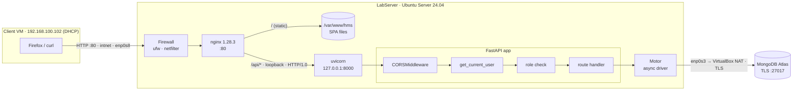
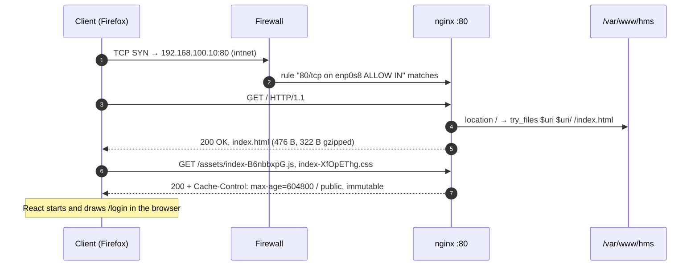
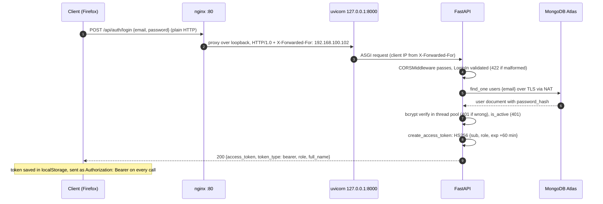
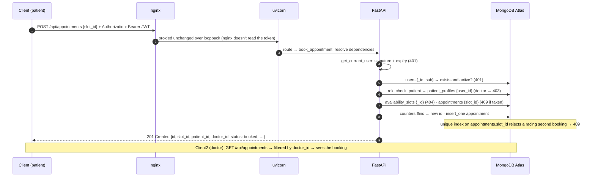
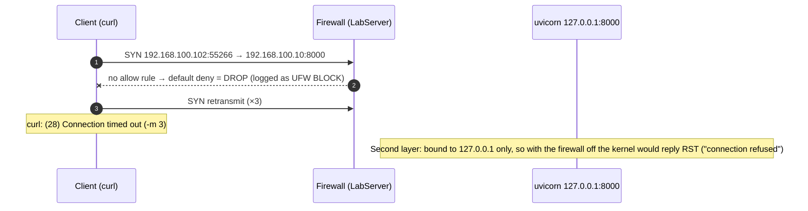

# Request Flow — how a request crosses the system

How one HTTP request travels from a client VM through LabServer to MongoDB Atlas
and back. Four scenarios, each showing a different component's job. An interactive,
step-by-step version exists for presenting (private claude.ai artifact *HMS Request
Path*). Topology: [ADR-0016](adr/ADR-0016-lab-topology-server-plus-two-clients.md);
deployment details: [labserver-setup-log.md](labserver-setup-log.md).

## Components



| Component | Job | Where it's configured |
|-----------|-----|-----------------------|
| **Firewall** (ufw) | Kernel firewall: lets in 80 on `enp0s8` and 22 on `enp0s3` and silently drops everything else | `deploy/server-provision.sh` |
| **nginx** | Single entry point: serves the SPA files and reverse-proxies `/api/`, `/docs`, `/openapi.json` | `deploy/nginx-setup.sh` |
| **uvicorn** | ASGI server: parses HTTP into Python requests; listens on loopback only | `deploy/hms-api.service` |
| **CORSMiddleware** | Cross-origin rules. Deployed traffic is same-origin, so it only matters for the Vite dev server | `backend/app/main.py` |
| **get_current_user** | Verifies the JWT signature and expiry, then loads the user from Atlas → 401 on failure | `backend/app/api/deps.py` |
| **role check** | `require_role(...)` or a per-route branch → 403 for the wrong role | `backend/app/api/deps.py`, route modules |
| **route handler** | The business logic: reads and writes documents | `backend/app/api/routes/*.py` |
| **Motor** | Async MongoDB driver with a pooled TLS connection to Atlas | `backend/app/db/mongo.py` |

## 1. Load the page — `GET /`

nginx answers on its own; the API is never involved.



## 2. Log in — `POST /api/auth/login`



## 3. Book a slot — `POST /api/appointments` (main trace)



## 4. Hit port 8000 directly — blocked



Real kernel log entry for this attempt:

```
[UFW BLOCK] IN=enp0s8 OUT= SRC=192.168.100.102 DST=192.168.100.10 LEN=60 TTL=64 PROTO=TCP SPT=55266 DPT=8000 WINDOW=64240 SYN
```

## Where each status code comes from

| Code | Raised by | Example |
|------|-----------|---------|
| 200 / 201 | route handler | login · booking created |
| 401 | `get_current_user` / `login()` | no token, bad or expired token, wrong password, deactivated account |
| 403 | role check | patient calling `GET /api/users`, doctor booking a slot |
| 404 | route handler | unknown slot or appointment id |
| 405 | FastAPI router | `DELETE /api/health` |
| 409 | handler + unique index | slot already taken, email already registered |
| 422 | pydantic validation | missing fields, password over 72 bytes |
| 502 | nginx | uvicorn not running behind the proxy |
| timeout | Firewall (DROP) | any port other than 80/22 |
